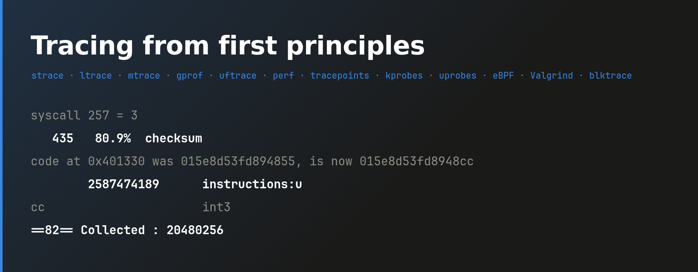
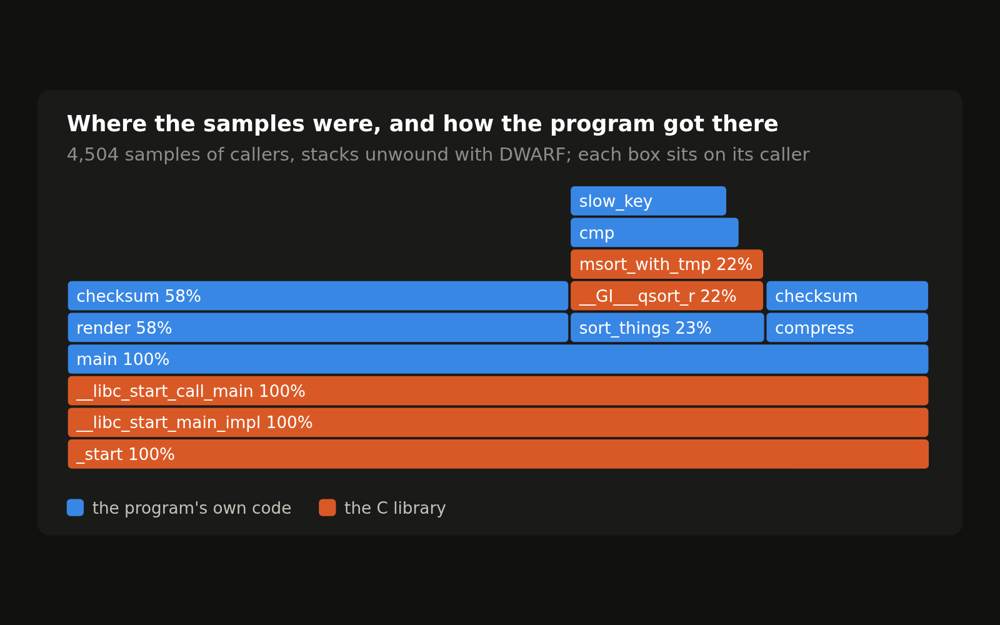
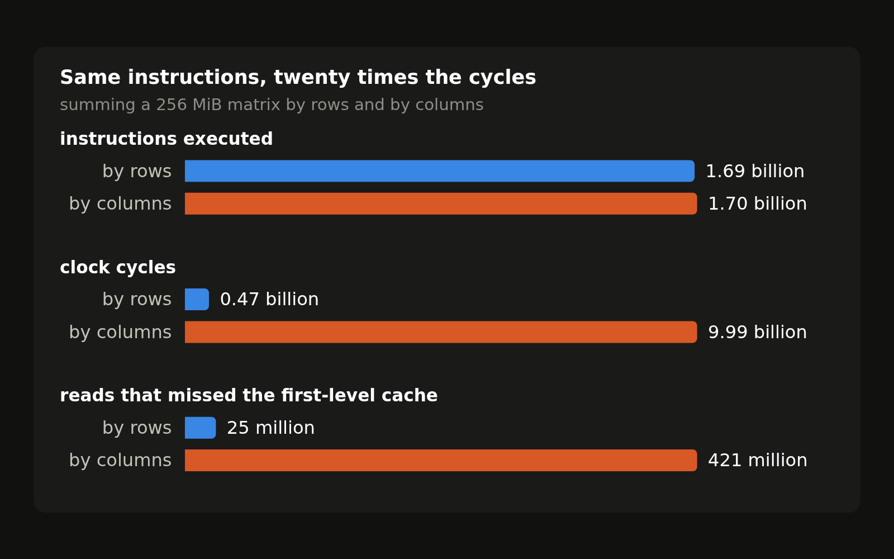
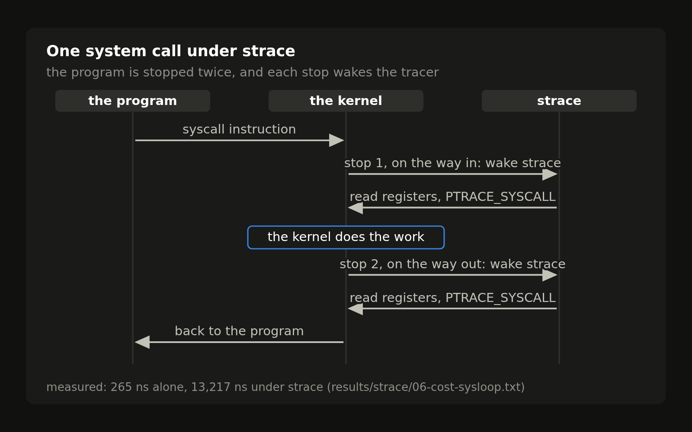
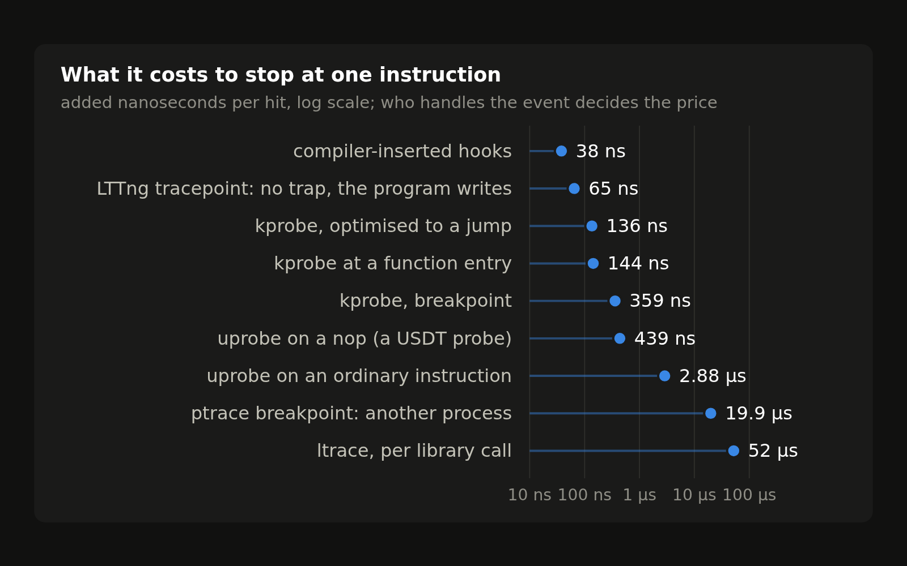

<p align="center"></p>

The experiments behind [Tracing from first principles](https://astrolabe.avicenna.space/Zombies/Tracing%20from%20first%20principles), a series of notes on Linux tracing tools: strace, ltrace, mtrace, gprof, uftrace, perf, tracepoints, kprobes, uprobes, eBPF, Valgrind and blktrace. Every number and every piece of output the notes quote is a file under `results/`, and one command regenerates it on your own kernel.

It is for engineers who use these tools and want to know how each one gets its data and what that costs the program being watched: which mechanism a tool stands on (ptrace, a patched instruction, a compiler hook, a hardware counter, a kernel hook, binary translation), what it can and cannot see, and how many nanoseconds each observed event adds.

<p align="center">
  
  
</p>
<p align="center">
  
  
</p>

## What is here

- **Thirteen experiments, one per note**: each is a `run.sh` and a handful of small C programs that the note discusses, such as a strace in one page, a ptrace breakpoint that writes `0xCC` by hand, or a BPF program assembled without a compiler.
- **Measured costs**: every tool is timed on a loop of known length with and without it attached, giving a cost per event, reported as the median of several runs with minimum and maximum.
- **Output you can read without the script**: each result file starts with the command that produced it, followed by its output, and `env.txt` records the kernel, CPU, compiler, glibc and tool versions of the run.
- **Root-level tools without touching the host**: perf, tracepoints, kprobes, uprobes, eBPF and blktrace run inside a throwaway KVM guest that boots your own kernel, so the results describe that kernel and its PMU.
- **Figures from the results**: `tools/figs.py` redraws every chart in the notes from the files under `results/`.

## Run

```sh
git clone https://github.com/ZahakJ/tracing-from-first-principles
cd tracing-from-first-principles
./lab/run.sh strace            # one experiment
./lab/run.sh all               # every experiment
```

Needs Docker. Experiments marked VM below also need a writable `/dev/kvm` and a readable kernel image (`/boot/vmlinuz-linux`, or `KERNEL=/path/to/bzImage`) with virtio-blk and ext4 built in. The first run builds the image, which takes a few minutes; the first VM run also turns it into a guest root filesystem. `./lab/run.sh smoke-container` and `./lab/run.sh smoke-vm` check that the tools are present and that ptrace, the PMU, tracefs and BPF work in each mode.

A result file looks like this (`results/strace/04-slowcat-strace-c.txt`):

```
$ strace -c ./fastcat < in.4M > out
% time     seconds  usecs/call     calls    errors syscall
------ ----------- ----------- --------- --------- ----------------
 63.36    0.000287           4        64           write
 36.64    0.000166           2        66           read
```

## Use

| Note | Experiment | Runs in | What it shows |
|---|---|---|---|
| Six ways to watch a program | `mechanisms` | container | printf, compiler hooks, a signal-driven sampler, a ptrace breakpoint, an LD_PRELOAD shim and a single-stepper, each in a page of C, with their cost per event |
| strace | `strace` | container | a 55-line strace; a program that hides its error; the cost of ptrace per system call; fault injection |
| ltrace | `ltrace` | container | the PLT stub, the 0xCC in it, the cost per call, the builds ltrace cannot see |
| mtrace | `mtrace` | container | counting, mtrace, heaptrack, AddressSanitizer, memcheck on the same leak; what interposers miss |
| gprof and uftrace | `gprof-uftrace` | container | what `-pg` inserts; gprof attributing time backwards; uftrace; cost per call |
| perf stat | `perf-stat` | VM | same instructions, 20x the cycles; perf_event_open by hand; multiplexing |
| perf record | `perf-record` | VM | sampling, skid, frame pointers vs DWARF vs LBR, a flame graph, the blind spot |
| Tracepoints | `tracepoints` | VM | a tracepoint's bytes off and on; strace vs perf trace vs the ring buffer; why a program waited |
| kprobes and uprobes | `kprobes-uprobes` | VM | the kernel patching itself (nop, call, int3, jmp); a program watching its own breakpoint; USDT; LTTng |
| eBPF and bpftrace | `ebpf` | VM | a BPF program assembled by hand; the verifier refusing five programs; the cost of a program at a hook |
| Valgrind | `valgrind` | container | a translated block; exact counts; callgrind, cachegrind, memcheck |
| Following a write to the disk | `blktrace` | VM | where a write is 30 s after `write()` returns; what one fsync costs the disk |
| Which tracer do I reach for | `one-bug` | VM | one slow program through eight tools, in order |

Output lands in `results/<experiment>/`: one file per thing a note quotes, plus `env.txt` (kernel, CPU, tool versions) and `run.log`. `python3 tools/figs.py` redraws `figures/` from it (needs `rsvg-convert`); `python3 tools/figs.py strace perf-stat` redraws only the named groups.

| Variable | Default | Effect |
|---|---|---|
| `KERNEL` | `/boot/vmlinuz-linux` | kernel the VM boots |
| `TIMEOUT` | `900` | seconds before a run is killed |
| `VM_CPUS` | `4` | vCPUs in the VM |
| `KARGS` | | extra kernel command-line arguments |
| `EXCLUSIVE` | | `1`: wait until no other experiment is running |

At most two experiments run at once; `EXCLUSIVE=1` gives a run the machine to itself, for timings that should not share the CPU.

The results in this repository were produced on Linux 7.1.8 with a Debian 13 userspace.

## How it works

One Debian 13 image holds every tool. A container experiment runs in it as an unprivileged Docker container with no network, which is enough for anything built on ptrace or LD_PRELOAD. A VM experiment needs root over a real kernel: the same image is exported to an ext4 file and booted as the root filesystem of a KVM guest running the host's own kernel, with `-cpu host` so the guest sees the host's performance counters. There is no initramfs and no init system: a small shell script runs as PID 1, mounts tracefs, debugfs and bpffs, lowers `perf_event_paranoid`, runs the experiment as root and powers off through `/proc/sysrq-trigger`. The experiment goes in on one virtio disk, its results come back as a tar on another, and the root disk is a snapshot, so every guest write is discarded. The host is never traced.

## Docs

- [Architecture](docs/ARCHITECTURE.md): the runner, both modes, the guest's disks and init, locking, results and figures.
- [Experiments](docs/EXPERIMENTS.md): each experiment's programs and output files.
- [Writing an experiment](experiments/README.md): the contract a `run.sh` follows.

The ftrace note has its own repository, [ftscope](https://github.com/ZahakJ/ftscope).

## License

MIT
